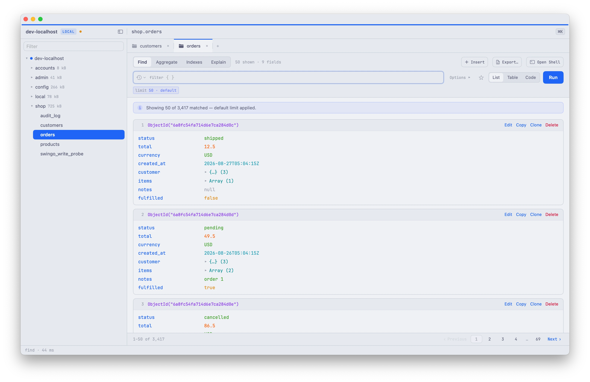
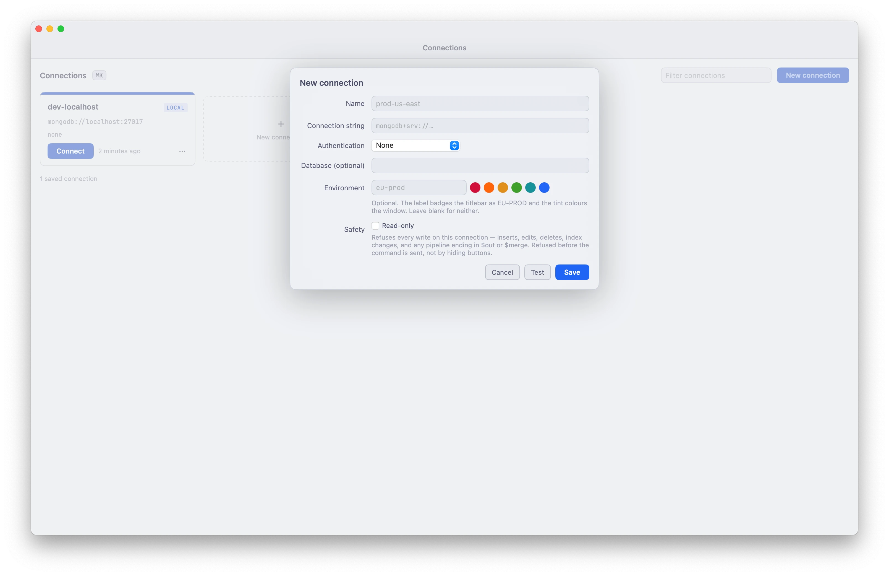
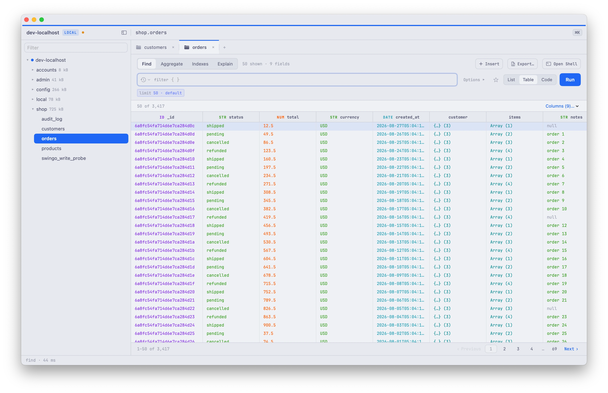
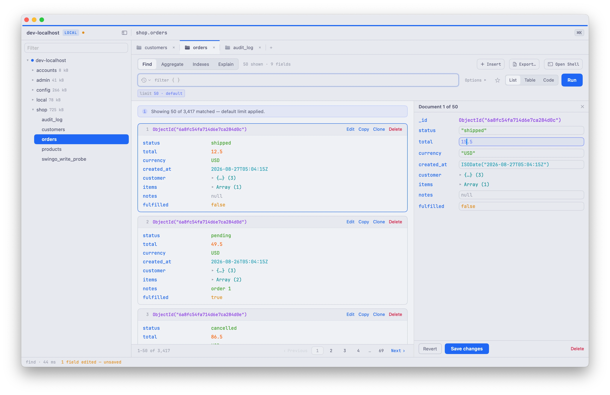
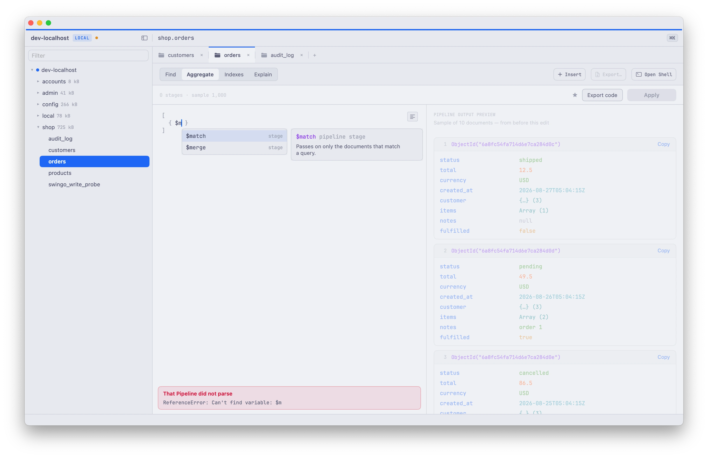
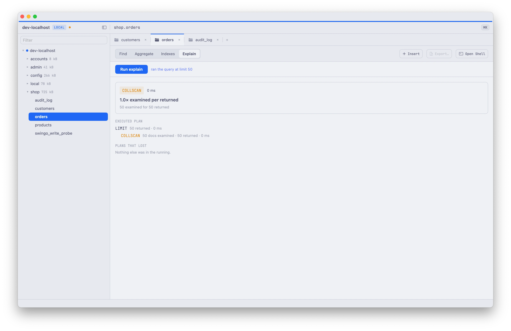
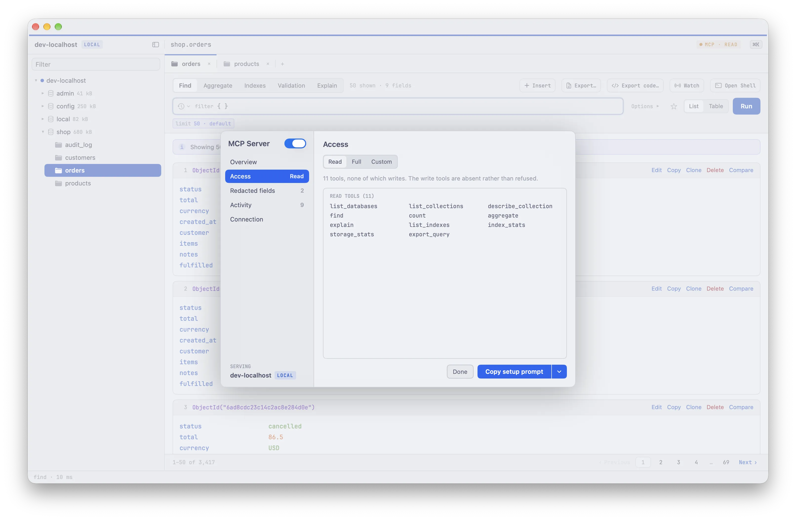

# Swingo

<p align="center">
  
</p>

<p align="center">
  
  
</p>

A native macOS client for MongoDB that never runs an unbounded query against your cluster.



Swingo connects to a MongoDB cluster, browses what is in it, and runs queries against it. The
whole app is built around one rule: nothing it sends can run away with your database.

Every query gets a limit, 50 documents when you do not set one, and the app tells you it did
rather than quietly deciding for you. Every command that can scan also carries a two second
budget that the server enforces, so when something is too slow the server stops it.

This repository holds the release builds. Swingo's source is not public.

## Download

1. Open the [latest release](https://github.com/derangga/swingo-releases/releases/latest) and
   download `Swingo-<version>.zip`.
2. Unzip it and move `Swingo.app` into `/Applications`.
3. Open it once using the steps below.

Requires macOS 15 or later on an Apple Silicon Mac. Developed and tested against MongoDB 8.0.

### Opening Swingo the first time

Swingo is not signed with an Apple developer account or notarized, so macOS blocks it the
first time it opens. You do this once per machine. Right-click and Open no longer works for
this on macOS 15.

**Option 1: System Settings**

1. Double-click `Swingo.app`. macOS says it can't verify Swingo. Click **Done**, not Move to
   Trash.
2. Open **System Settings → Privacy & Security** and scroll down to Security. It says
   `Swingo.app` was blocked.
3. Click **Open Anyway**, then confirm in the dialog that follows.

**Option 2: Terminal**

```bash
xattr -dr com.apple.quarantine /Applications/Swingo.app
```

This removes the download flag macOS checks. Swingo then opens with no prompt.

## Features

### Connections

Save a cluster with a name, a connection string and its credentials. The password is kept out
of the connection string and starred wherever the string is drawn. Give a connection an
environment label and a colour, and every window it opens wears them, so a production window
never looks like a scratch one.

Tick **Read-only** and the app refuses every write before sending it: inserts, edits, deletes,
index changes, and any pipeline ending in `$out` or `$merge`.



### Find

Type a filter in the syntax you use in mongosh, with projection, sort, skip and limit beside
it. Read the result as a list, as a table with a type on every column, or as code you can
copy. Page through the matches instead of raising the limit.



### Editing

Open a document in the inspector, change a field, and see how many fields you have touched
before you commit. Saving writes only what differs. Insert, clone and delete are there too,
and delete names the document it is about to remove.



### Aggregate

Build a pipeline one stage at a time and see what each stage returns as you type. Previews
run against a capped slice of the collection, so editing a stage cannot turn into a scan of
it. Export the finished pipeline as mongosh text.



### Indexes and Explain

Every index on a collection with its keys, its size and its properties. Create one from a
form that shows the name the server will give it, and drop one by typing that name back.

Explain shows which index served the query, or that none did and it read the whole
collection, and how many documents it examined to return what it returned. When the time
budget cuts a plan short, the numbers are labelled as a floor, not a total.



### MCP server

Swingo can serve a connection to an AI agent over MCP. In **Read** mode the agent gets 11
tools and none of them write: the write tools are absent, not refused. **Full** and **Custom**
widen that. You can redact fields from what the agent sees, and an Activity tab logs what it
did.



### Getting around

`⌘K` opens a palette that reaches any collection, any saved query and any command without the
mouse. Each tab remembers the queries it has already run. Star a query or a pipeline and it
lands in the sidebar.

## What it does not do

- **No schema view.** Describing a collection means sampling it, and a sample large enough to
  describe one is a scan of it. On a collection of 3,417 documents, asking for 171 at random
  already reads all of them.
- **No unbounded reads.** There is no "load everything" button, because there is no safe
  version of one.
- **Not a shell.** No scripts, no server administration, no user management.

## Feedback

Open an [issue](https://github.com/derangga/swingo-releases/issues) for bugs and requests.
Say which version you are on (Swingo → About Swingo) and what the cluster is, such as a local
Docker instance or Atlas.

## License

Apache License 2.0, see [LICENSE](./LICENSE) and [NOTICE](./NOTICE). The Swingo name and icon
are trademarks, see [TRADEMARKS.md](./TRADEMARKS.md).
